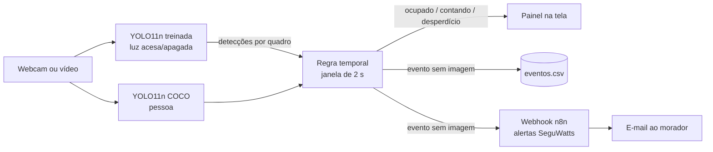

# SeguWatts Vision

**Câmera que reconhece luz e TV ligadas em cômodo vazio e transforma isso em alerta de desperdício.**

Componente **Visão** do SeguWatts (Global Solution 2026.2, FIAP, Engenharia de Software, 4º ano), disciplina **Applied Computer Vision**: detecção de objetos em tempo real com uma YOLO treinada pela equipe.

| | |
|---|---|
| Relatório da disciplina | [docs/relatorio.md](docs/relatorio.md) (exportar para PDF) |
| Vídeo de demonstração | `[preencher]` |
| Notebook de treino | [notebooks/treino_colab.ipynb](notebooks/treino_colab.ipynb) |
| Produto completo | [Vitrine SeguWatts](https://github.com/dejesuscaua/Global-Solution) |

## O problema

O SeguWatts mostra quando, onde e quanto a casa gasta energia, e avisa quando um aparelho passa a gastar acima do normal. Há, porém, um desperdício que nenhum medidor de consumo enxerga: o aparelho funcionando normalmente, mas **ligado sem ninguém usando**.

O EcoBot, componente físico do projeto, tentou detectar isso com um sensor de luz (LDR), e o próprio relatório dele registra o limite: o LDR não diferencia sol de lâmpada e não sabe se há alguém no cômodo. A visão computacional responde às duas perguntas.

## Como funciona



| Detecção | Modelo |
|---|---|
| `lampada_acesa` / `lampada_apagada` | **YOLO11n treinada pela equipe** com um dataset público de lâmpadas do Roboflow Universe (`Lamp On`, `Light Bulb On`, `Lamp Off`, `Light Bulb Off`) |
| `pessoa` | YOLO11n pré-treinada no COCO, rodando no mesmo quadro |
| `tela_ligada` / `tela_desligada` | a YOLO COCO acha a TV; o estado vem do **brilho da tela** (`estado_tela()` em `config.py`): tela bem mais clara que o quadro, ou com imagem, conta como ligada |

Os nomes de classe de qualquer dataset são traduzidos para o vocabulário do SeguWatts por `normalizar_classe()` (`seguwatts_vision/config.py`), com testes em `tests/test_config.py`.

**Regra de desperdício** ([`seguwatts_vision/regra.py`](seguwatts_vision/regra.py)):

- **Aparelho ligado:** luz acesa ou tela ligada em pelo menos 70% dos quadros dos últimos 2 s.
- **Cômodo ocupado:** pessoa em pelo menos 30% dos quadros. A assimetria é proposital: um falso "vazio" geraria alerta incômodo, então basta a pessoa aparecer em parte dos quadros.
- **Evento:** abre depois de 120 s de cômodo vazio com aparelho ligado (10 s com `--demo`). Fecha quando alguém volta ou o aparelho é desligado.
- **Estimativa:** energia e custo calculados com potências típicas (luz LED de 12 W, TV de 90 W) e a tarifa configurada.
- **Medida em segundos, não em quadros:** a regra se comporta igual com qualquer FPS.

Exemplo de evento enviado ao n8n:

```json
{
  "id": "c293ca0b7975",
  "tipo": "encerrado",
  "comodo": "sala",
  "aparelhos": ["lampada_acesa", "tela_ligada"],
  "vazio_desde": "2026-11-15T22:03:24+00:00",
  "aberto_em": "2026-11-15T22:05:24+00:00",
  "encerrado_em": "2026-11-15T22:31:10+00:00",
  "duracao_s": 1666.0,
  "energia_estimada_kwh": 0.047203,
  "custo_estimado_rs": 0.040123
}
```

## Como rodar

**Sem instalar nada:** todo o fluxo roda no Google Colab. O [notebook](notebooks/treino_colab.ipynb) treina o modelo, mede as métricas e, na célula 10, processa um vídeo gravado no celular com o detector deste repositório, devolvendo o vídeo anotado e o CSV de eventos. A célula 11 roda **ao vivo com a webcam do navegador**: o Colab captura os quadros por JavaScript e `seguwatts_vision/ao_vivo.py` aplica os modelos e a regra a cada quadro, mostrando o painel e os eventos em tempo real.

**No computador (webcam ao vivo):**

Requisitos: Python 3.10+ e uma webcam.

```bash
git clone https://github.com/dejesuscaua/Gs-visaocomputacional.git
cd Gs-visaocomputacional
python -m venv .venv
source .venv/bin/activate            # Windows: .venv\Scripts\activate
pip install -r requirements.txt
```

**Antes de treinar** (teste de câmera, regra e webhook com os pesos COCO):

```bash
python -m seguwatts_vision.detector --pre-treinado --demo
```

Nesse modo o COCO reconhece pessoa e TV (estado pelo brilho da tela), mas não lâmpadas. Serve para testar a integração.

**Com o modelo da equipe** (`modelo/best.pt`, gerado pelo notebook):

```bash
python -m seguwatts_vision.detector --demo                      # webcam, alerta em 10 s
python -m seguwatts_vision.detector --comodo quarto --limite 300
python -m seguwatts_vision.detector --fonte video.mp4 --saida resultados/demo.mp4 --sem-janela
```

Teclas: `q` sai, `d` alterna o modo demonstração.

Configuração por variável de ambiente (ver `.env.example`): `COMODO`, `LIMITE_SEGUNDOS`, `TARIFA_RS_KWH` e `SEGUWATTS_WEBHOOK_URL` (só `https`). Sem webhook, os eventos vão só para `resultados/eventos.csv`. Se a internet cair, o evento fica no CSV com `enviado=false` e o detector continua.

## Treino e avaliação

1. Crie uma conta gratuita no Roboflow e salve a chave da API nos *Secrets* do Colab como `ROBOFLOW_API_KEY`. O notebook baixa o dataset público já anotado (ou um dataset próprio, ver [dataset/README.md](dataset/README.md)).
2. Abra [notebooks/treino_colab.ipynb](notebooks/treino_colab.ipynb) no Colab com GPU T4 e rode todas as células. Ele treina a YOLO11n, avalia no conjunto de teste, mede o FPS e baixa um `.zip` com `modelo/` e `resultados/`.
3. Descompacte o `.zip` na raiz deste repositório.

Para reavaliar ou medir o FPS na máquina da demonstração:

```bash
python scripts/avaliar.py --dados caminho/para/data.yaml      # resultados/metricas_teste.json
python scripts/medir_fps.py --fonte 0                          # resultados/fps.json
```

## Resultados

| Métrica (conjunto de teste, 34 imagens) | Valor |
|---|---|
| mAP@50 | **0,783** |
| mAP@50-95 | **0,529** |
| Precisão | 0,706 |
| Recall | 0,709 |
| mAP@50 luminária acesa / apagada | 0,896 / 0,924 |
| FPS em CPU, sem GPU (640 / 480 px) | 9,9 / 12,2 |

Dataset: [Light Detection v3](https://universe.roboflow.com/infocomm-thingy/light-detection-gecjq/dataset/3) (Roboflow Universe, 695 imagens, CC BY 4.0). Treino: YOLO11n a partir do COCO, parada antecipada na época 69 (melhor na 49), ~10 min numa T4.

Figuras em `resultados/`: curvas de treino, matriz de confusão, curva precisão × recall e exemplos de detecção.

**Validação da integração (antes do treino).** Rodamos o detector em modo `--pre-treinado` sobre um vídeo de teste de 26 s em três fases (pessoa com a TV, sala vazia com a TV, pessoa volta). Abriu um único evento depois do tempo-limite, o evento foi encerrado quando a pessoa voltou, os dois chegaram ao webhook e foram gravados no CSV. O detector rodou a ~17 FPS com entrada de 640 px na CPU do ambiente de testes (22 FPS no benchmark isolado).

## Testes

```bash
pip install -r requirements-dev.txt
pytest -q
```

São 41 testes, rodados no GitHub Actions a cada push. Cobrem a regra (evento abre uma única vez, fecha quando a pessoa volta ou a luz apaga, ignora quadros isolados e detecções fracas, não depende do FPS, aquecimento ao ligar a câmera), a tradução dos nomes de classe dos datasets, o estado da TV pelo brilho e a saída de eventos (CSV, webhook, falha de rede, recusa de `http` sem TLS).

## Privacidade e ética (LGPD)

- **Nenhuma imagem é salva ou transmitida.** O processamento acontece no computador da casa, e só o evento (cômodo, aparelhos, horários, estimativa) sai.
- O dataset só tem pessoas que autorizaram, e as fotos não são publicadas (ficam no Roboflow, privado).
- Câmera dentro de casa exige consentimento de todos os moradores. O SeguWatts Vision é opcional e pode ser desligado a qualquer momento.
- A decisão final é humana: o evento sugere uma verificação, não desliga nada sozinho.

## Estrutura

```text
seguwatts_vision/
  detector.py       tempo real: câmera ou vídeo, YOLO, painel e gravação
  ao_vivo.py        processamento quadro a quadro (webcam do navegador no Colab)
  regra.py          regra de desperdício com suavização temporal (sem dependência de câmera)
  eventos.py        CSV local e webhook do n8n
  config.py         classes, potências e configuração por ambiente
notebooks/treino_colab.ipynb   treino, avaliação, FPS e exportação
scripts/avaliar.py             métricas no conjunto de teste
scripts/medir_fps.py           FPS e latência em CPU
dataset/                       protocolo de coleta e anotação, data.yaml de referência
docs/relatorio.md              documento da disciplina
docs/roteiro_video.md          roteiro do vídeo
tests/                         testes da regra e dos eventos
```

## Equipe

| Nome | RM |
|---|---|
| Cauã Gonçalves de Jesus | RM97648 |
| Davi Passanha de Sousa Guerra | RM551605 |
| Luan Silveira Macea | RM98290 |
| Luigi Ferrara Sinno | RM98047 |
| Rui Amorim Siqueira | RM98436 |
